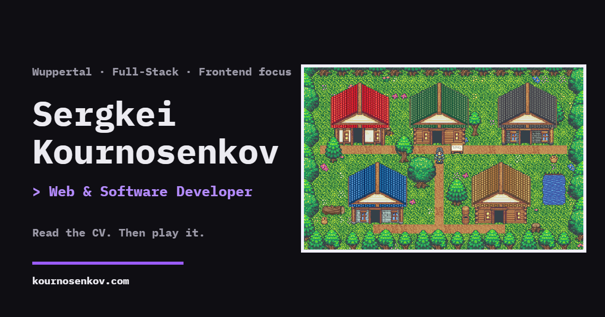

# Sergkei Kournosenkov — Interactive CV

**Web & Software Developer · Full-Stack with a frontend focus · Wuppertal, Germany**

### [→ www.kournosenkov.com](https://www.kournosenkov.com)

[](https://www.kournosenkov.com)

My CV as a website: a terminal-styled résumé you can read in English, German or Greek. Scroll past the end and it glitches into a small retro RPG village where every building opens a part of the CV. It also has a portfolio with case studies and a printable A4 CV, all generated from one data source.

Built from scratch in **vanilla TypeScript**, with no framework or UI library.

---

## What's inside

| | |
|---|---|
| **Terminal CV** | Profile, experience, skills, education and languages, with a working fake shell (`help`, `whoami`, `stack`, `play`, `lang de`, `theme` …). Dark and light themes. |
| **Selected work** | Project cards with looping before/after videos and a case-study drawer (problem, approach, result, Lighthouse scores). The full list lives on a separate portfolio page. |
| **RPG mode** | A 32×21-tile pixel-art village on `<canvas>`. Walk with the keyboard, click/tap to pathfind (BFS), swipe or pinch to zoom on mobile. Guild Hall = jobs, Armory = skills, Academy = education, Tavern = languages, Post Office = contact form. Chiptune sound effects come from the Web Audio API. |
| **Printable CV** | An HR-friendly A4 version rendered from the same data, in all three languages. |
| **Contact form** | Sends mail through a serverless function, with validation and spam protection. |

## Engineering highlights

- **No framework, still type-safe.** Rendering is plain template strings with mandatory escaping. All content lives in two typed data files, and the compiler fails the build if a single string is missing its German or Greek translation.
- **Security.** The site runs under a strict Content Security Policy with **Trusted Types** enforced, so every piece of HTML goes through a single function. It loads no third-party scripts, fonts or origins.
- **Privacy by design (GDPR).** No cookies and no consent banner needed. Fonts are self-hosted and analytics are cookieless and first-party.
- **SEO and AI discoverability.** A custom Vite plugin generates real per-language URLs (`/en/`, `/de/`, `/el/`) with hreflang, canonical and Open Graph tags. It also writes a full no-JavaScript HTML copy of the CV for crawlers, `sitemap.xml`, and [`llms.txt`](https://www.kournosenkov.com/llms.txt) / `llms-full.txt` for AI agents. All of it is built from the same CV data, so it never goes stale.
- **Performance.** CSS is inlined at build time (no render-blocking requests), fallback fonts are metric-matched so text doesn't shift when the real fonts load, and videos load only when they scroll into view.
- **Accessibility.** Full keyboard navigation (including the game), skip link, ARIA states and dialogs, and support for `prefers-reduced-motion`.
- **Automated media.** A Playwright + ffmpeg script records the project videos and screenshots, including the "before" versions from the Wayback Machine.

## Tech stack

**Frontend:** TypeScript, Vite, HTML Canvas, Web Audio API, plain CSS (custom properties for theming)
**Backend:** Vercel Functions (Web `Request`/`Response`), Resend for email
**Tooling:** Playwright, ffmpeg, custom Vite plugins
**Hosting:** Vercel, with security headers, caching and Web Analytics

## Run locally

```bash
npm install
npm run dev       # http://localhost:5173
npm run build     # type-check + production build
```

<details>
<summary>Environment variables (optional)</summary>

Copy `.env.example` to `.env`.

- `VITE_VERCEL_ANALYTICS=true` turns on Vercel Web Analytics (it never runs on localhost).
- `RESEND_API_KEY`, `CONTACT_TO` and `CONTACT_FROM` configure the contact form. These are server-side only; test them with `vercel dev`.

</details>

## Contact

- **Website:** [kournosenkov.com](https://www.kournosenkov.com)
- **LinkedIn:** [Sergkei Kournosenkov](https://www.linkedin.com/in/sergkei-kournosenkov-10659592/)
- **Email:** [ser.corum@gmail.com](mailto:ser.corum@gmail.com)
